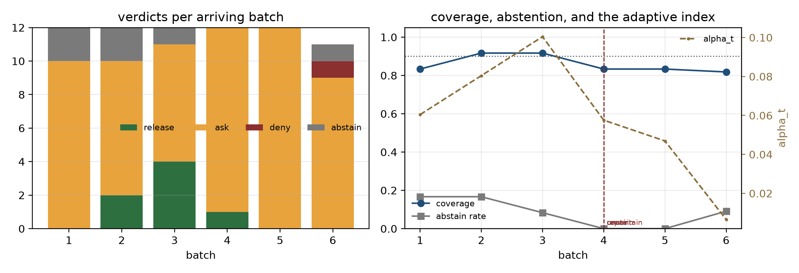
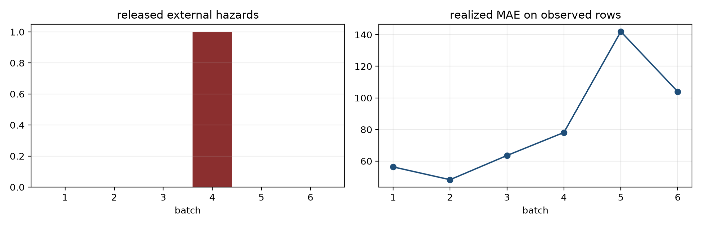

# Flywheel deployment report — diabetes regressor

**Question.** With a model trained once, does a live decision harness keep the *decisions* safe as batches arrive, what does it detect, and what does it change — without letting learning enter admission?

## Setup

- model: RandomForestRegressor, 10 features, trained on 60%; conformal κ on 20% (α=0.10, adaptive ACI).
- policy: release if the whole conformal interval clears 240; deny if entirely above; ask if it straddles.
- external hazard: age > 0.1 (underwriting spec), injected in batches 4 and 6; staged drift (target +80 from batch 3, +80 again from batch 5).
- readiness: approved=True (sha256:3c2e87af91a96…), gates: calibration_present=PASS, overclaim=PASS, precision=PASS, recall=PASS, coverage=PASS, abstain_rate=PASS.

## Batch timeline

| batch | n | release | ask | deny | abstain | coverage | MAE | alpha_t | hazard releases | contained |
|---:|---:|---:|---:|---:|---:|---:|---:|---:|---:|:--:|
| 1 | 12 | 0 | 10 | 0 | 2 | 0.833 | 56.3 | 0.060 | 0 | no |
| 2 | 12 | 2 | 8 | 0 | 2 | 0.917 | 48.2 | 0.080 | 0 | no |
| 3 | 12 | 4 | 7 | 0 | 1 | 0.917 | 63.5 | 0.100 | 0 | no |
| 4 | 12 | 1 | 11 | 0 | 0 | 0.833 | 78.1 | 0.058 | 1 | yes |
| 5 | 12 | 0 | 12 | 0 | 0 | 0.833 | 142.0 | 0.047 | 0 | no |
| 6 | 11 | 0 | 9 | 1 | 1 | 0.818 | 103.9 | 0.007 | 0 | no |

## What the flywheel detected

| batch | detector | lever | severity | stat | evidence |
|---:|---|---|---|---:|---|
| 2 | error_high | proposer | warning | 84.03 | CUSUM 84.03 vs h=10.00; target=49.824, slack=2.000, n=24, MDE=2.0 |
| 4 | abstain_high | contract | warning | 5.55 | CUSUM 5.55 vs h=5.00; target=0.200, slack=0.010, n=48, MDE=0.05 |
| 4 | hazard_release | contract | critical | 1.0 | 1 release(s) on external hazard rows |

Detectors are sequential CUSUMs with declared targets, slack, thresholds, minimum n and minimum detectable effects; `tick()` is recomputed from the journal, so the same journal yields the same alarms.

## What it did

- containment at batch 4 (unconditional, release → ask);
- repair ChangeSet promoted at batch 4 (adding the missing deny rule is tightening: no approval needed);
- containment lifted at batch 4 with an external approval (loosening is signed).
- retraction ledger: 48 certificate(s) issued under the faulty v1 policy.

## Reading

- Coverage stayed near nominal (0.82–0.92 across batches) while the index paid in width: alpha_t fell from 0.100 to 0.007 and the policy asked on every row of the shock batch. The coverage CUSUM did not cross its declared threshold at this n; abstention was the visible protection. ACI learned; the admission relation did not.
- The hazard release is a *contract* failure, not a model failure: the interval was safe-looking, but the declared age band was not in the policy. The repair is a rule, and the repair is evidence-gated by replaying stored facts.
- Containment costs capability immediately and can only tighten; lifting it needs a signature the session does not hold. Promotion of a tightening change needs no signature.
- Retraction is version-scoped: every decision taken under v1 is listed (48 certificates) for risk-owner triage; rollback alone would not create that record. The second injected hazard (batch 6) was denied by v2, not contained — the repair works without another emergency.

- ACI ended with alpha_t = 0.0066 (nominal 0.10): the index widened after errors and narrowed again as coverage recovered.

## Human-in-the-loop queue

The live session exposes abstentions as a review queue; the run ended with 71 decisions and 6 abstentions. Examples:
- batch 1: `uncovered` — cannot decide: no policy statement fires for this prediction (uncovered is abstain, never release)

## What this run changed in the design

- **The oracle must encode the declared hazard.** The first run scored correctness as `y <= threshold` only. The injected row was safe by outcome but hazardous by contract, so the pair rewarded releasing it and the Pareto gate rejected the correct repair. The oracle now marks any hazard row as `safe=False`; the pair and the hazard ledger agree on what a false certificate is.
- **The hazard detector must be epoch-aware.** After the repair and the lifting of containment, the historical hazard release re-triggered containment on every tick. The detector now counts only releases after the last uncontainment: history is retracted, not re-paged.
- **Warnings do not act.** The early `error_high` alarm was a false alarm (MAE was stable); only the critical hazard alarm triggered an automatic action. That is the intended asymmetry.

## Figures

## Limits

Synthetic drift and an injected, deterministic hazard; small batches (n≈12) and a single seed; the approval demo uses HMAC with the signing key held outside the session (production: asymmetric signatures). Label delay is zero in this run — outcomes are joined immediately, which is optimistic for coverage monitoring; a real feed needs audit sampling of abstained/denied rows to avoid selection bias.
